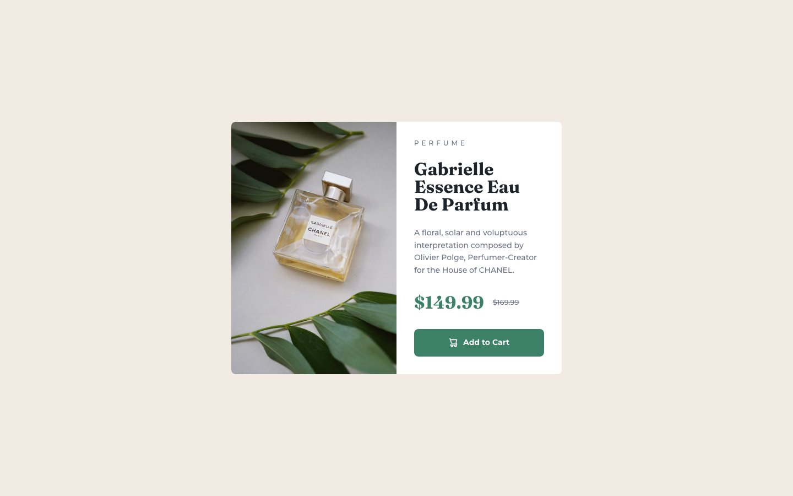

# Frontend Mentor - Product preview card component solution

This is a solution to the [Product preview card component challenge on Frontend Mentor](https://www.frontendmentor.io/challenges/product-preview-card-component-GO7UmttRfa). Frontend Mentor challenges help you improve your coding skills by building realistic projects.

## Table of contents

- [Overview](#overview)
  - [The challenge](#the-challenge)
  - [Screenshot](#screenshot)
  - [Links](#links)
- [My process](#my-process)
  - [Built with](#built-with)
  - [Notes](#notes)
  - [Running locally](#running-locally)
  - [AI Collaboration](#ai-collaboration)
- [Author](#author)

## Overview

### The challenge

From the Frontend Mentor brief:

> Your challenge is to build out this product preview card component and get it looking as close to the design as possible.
>
> Your users should be able to:
>
> - View the optimal layout depending on their device's screen size
> - See hover and focus states for interactive elements

### Screenshot



### Links

- Solution URL: [Add solution URL here](https://your-solution-url.com)
- Repository: [github.com/temivan/product-preview-card](https://github.com/temivan/product-preview-card)
- Live Site URL: [Add live site URL here](https://your-live-site-url.com)

## My process

### Built with

- Semantic HTML5 markup
- CSS Grid and Flexbox
- Mobile-first workflow
- [React](https://react.dev/) with TypeScript
- [Vite](https://vite.dev/) - build tool
- [Tailwind CSS v4](https://tailwindcss.com/) - via the official Vite plugin, with design tokens in a `@theme` block
- Self-hosted Montserrat and Fraunces variable fonts
- [Oxlint](https://oxc.rs/docs/guide/usage/linter) and [oxfmt](https://oxc.rs/docs/guide/usage/formatter) - linting and formatting
- [pnpm](https://pnpm.io/) - package manager
- GitHub Actions and GitHub Pages - deployment

### Notes

- **Design tokens.** The style guide's six colours, the two font stacks and the Figma type presets live in a Tailwind `@theme` block in `src/index.css`. The default palette and fonts are cleared, so components can only use the named tokens.
- **Responsive layout.** Below 40rem (640px) the card stacks, with the landscape mobile image on top. From 40rem it becomes a 600px two-column grid with the portrait desktop image on the left. A `<picture>` element switches the image at the same breakpoint.
- **Accessibility.** The page has one `main` landmark and an `h1` for the product name. The prices have visually hidden "Current price" and "Original price" labels, and the original price is in `<s>`. The cart icon is hidden from assistive technology, so the button is announced as "Add to Cart".
- **Interaction states.** Hover turns the button from Green 500 to Green 700. Keyboard focus (`:focus-visible`) adds an offset Green 700 outline ring, so it looks different from hover and doesn't appear on mouse click.
- **Deployment.** Every push to `main` runs `.github/workflows/deploy.yml`, which lints, checks formatting, builds with pnpm and publishes `dist/` with the official Pages actions. Vite's `base` is `/product-preview-card/` so assets resolve under the repo path.

### Running locally

```sh
pnpm install
pnpm dev            # start the dev server
pnpm build          # type-check and build to dist/
pnpm preview        # serve the build at http://localhost:4173/product-preview-card/
pnpm lint           # Oxlint
pnpm format:check   # oxfmt check
```

### AI Collaboration

I used Claude Code to scaffold the tooling, build the card from the Figma frames, write the deploy workflow and draft this README. I reviewed the output against the design and the challenge requirements.

## Author

- GitHub - [@temivan](https://github.com/temivan)
